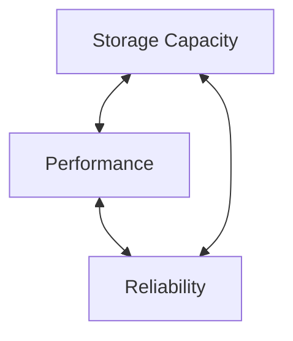

My Proxmox VE server is more then just a hypervisor, it is also my NAS.  I have an article on how I am achieving this using samba container <<insert article link here>>.  I use ZFS as my *"filesystem"*.   ZFS (Zettabyte File System) is widely recognised in the storage industry as more then a file system, it is a comprehensive SDS (software defined storage) platform.  It breaks  traditional storage models by combining the functionality of a filesystem, volume manager, and software RAID into one integrated layer, eliminating the need for hardware RAID controllers.  This has many advantages....along with technical overhead.

This is not a ZFS primer,  There is an internet full of documentation, howtos, and opinions out there.  I am documenting how I am configuring ZFS storage on my server.


## Start with the Physical Layer

Let's start list of the block devices I have:
```bash
lsblk -d -o name,model,size,serial,id-link

NAME    MODEL       SIZE 	 SERIAL             ID-LINK
sda     INTEL       745.2G BTWL505202K2800RGN wwn-0x55cd2e404b77e4ae
sdb     INTEL       745.2G BTWL411104HV800RGN wwn-0x55cd2e404b5dcf1c
sdc     INTEL       745.2G PHWL437602FS800RGN wwn-0x55cd2e404ba4d83c
sdd     INTEL       745.2G PHWL507100RA800RGN wwn-0x55cd2e404c4e0a5a
sde     SAMSUNG     894.3G S26DNXAH208170     wwn-0x5002538c401a460a
sdf     SAMSUNG     894.3G S1YHNX0H409025     wwn-0x5002538c4026ffcb
sdg     INTEL       745.2G BTWL411104LH800RGN wwn-0x55cd2e404b5dcf56
sdh     INTEL       745.2G BTWL502604A0800RGN wwn-0x55cd2e404b764101
sdi     SAMSUNG     894.3G S1YHNYAG200496     wwn-0x5002538c0000552c
sdj     SAMSUNG  		894.3G S1YHNYAG200486     wwn-0x5002538c00005522
sdk     HUS726040ALS210  3.6T K7J6XUZL           scsi-35000cca2697d55f4
sdl     HUS726040ALS210  3.6T K7J470XT           scsi-35000cca269786b84
sdm     HUS726040ALS210  3.6T K7JBLTLB           scsi-35000cca26985d68c
sdn     HUS724040ALS641  3.6T PCHHJMWX           scsi-35000cca05c549e28
sdo     HUS726040ALS214  3.6T K4HGAAAB           scsi-35000cca25d526df4
sdp     HUS726040ALS214  3.6T K4HG76PB           scsi-35000cca25d523f24
sdq     HUS726040ALS214  3.6T K4HG6BPB           scsi-35000cca25d52328c
sdr     HUS726040ALS214  3.6T K4HGEMJB           scsi-35000cca25d529f74
nvme1n1 Optane    260.8G    nvme-INTEL_SSDPED1D280GA_PHMB742300FA280CGN
nvme0n1 BIWIN     476.9G    nvme-BIWIN_NA80Y1M10-512G_2322004001627
```

> [!danger]
> Don't use raw device names like /dev/sda in zfs when creating vdevs.

Using raw device names (like /dev/sda, /dev/nvme0n1) when creating ZFS vdevs is **HIGHLY** discouraged because these names can change after a reboot, motherboard change, or cable swap, leading to imported pools appearing as "DEGRADED" or failing to import entirely. 

Instead, use persistent naming conventions located in /dev/disk/by-id/ or /dev/disk/by-path/. 
Recommended Naming Methods:
-  **/dev/disk/by-id/**: Uses unique WWN (World Wide Name) or serial number-based identifiers, such as ata-INTEL_SSDSC2BB800G4_BTWL505202K2800RGN. These persist even when drives are moved to different ports or to a new server
- **/dev/disk/by-path/**: Uses physical connection paths (PCIe slots, USB port, SAS controller port). Useful for identifying which physical slot a drive belongs to.

I prefere to use the WWN as this fount for a raw device name using lsblk  command`sblk -d -o name,model,size,serial,id-lin` like in the device listing above.  This helps as a lot of native linux commands and the Proxmox VE GUI is raw devices (/dev/sda).  Also when zfs reports a degraded pool, it is easier to match the *FAULTED* device to the serial number  number of the disk for replacement.

Proxmox VE 8.x and up havs had a stable implementation of booting from a ZFS mirrored pool.   The disks wwn-0x55cd2e404b77e4ae and wwn-0x55cd2e404b5dcf1c (sda and sdb)  where setup during the install as `rpool`
```bash
root@pve1:~# zpool status
  pool: rpool
 state: ONLINE
config:

        NAME                                                  STATE     READ WRITE CKSUM
        rpool                                                 ONLINE       0     0     0
          mirror-0                                            ONLINE       0     0     0
            ata-INTEL_SSDSC2BB800G4_BTWL505202K2800RGN-part3  ONLINE       0     0     0
            ata-INTEL_SSDSC2BB800G4_BTWL411104HV800RGN-part3  ONLINE       0     0     0
```
I will cover using a zfs mirror as a boot drive in more detail in another article.  But for now,  these are the boot/root device for my Proxmox VE server, so are a done deal and we'll just ignore them for now.

This leaves me with:
- 8 x 4T SAS HGST  HDDs (assortment of HUS* Drives)
- 4 x 800G SATA Intel SSDs
- 4 x 960G SATA Samsung SSDs
- 1 x 280G NVMe Intel OPTANE device (nvme-INTEL)
- 1 x 512G NVMe generic device (nvme-BIWIN)
{ .center style="border:2px solid #999"}

> [!info]
> Apart from the NVMe devices, these are all ex-datacenter drives, I have an article on the special treatment they need, and why I feel safe using these for my data, here <<insert article link here>>

## Define ZFS Core Conceptes 

Before going further and without going to far down a rabbit hole, I`ll go through some of the ZFS basics that will be applied my layout strategy so it make some sense 

### Storage Hierarchy

- **VDEV (Virtual Device)**: The fundamental building block of a zpool. A VDEV consists of one or more physical disks arranged in a redundancy layout (mirror, RAIDZ, etc.).

> [!warning] **Critical Note**  
> If a single VDEV is lost, the **entire zpool becomes unavailable**, even if all other VDEVs are healthy.

- **Pool (zpool)**: A storage aggregation layer that combines one or more VDEVs into a single logical storage space.
- **Dataset**: A lightweight filesystem within the pool. Unlike traditional partitions, datasets are dynamic and allow per-dataset configuration such as compression, quotas, snapshots, and permissions.
- **ZVOL**: A block device created within a pool, typically used for virtual machines or iSCSI storage.
- **Special VDEV**: A dedicated VDEV used to store metadata (and optionally small files), improving performance for metadata-heavy workloads.

### VDEV Layouts (RAID-like goodness)
ZFS does not rely on traditional hardware RAID.  It is Software Defined Storage (SDS) giving RAID-like redundancy at the VDEV level.  This incomplete list of layouts is what I will be using: 
- **Stripe (no redundancy)**: Data is spread across disks with no protection. If one disk fails, all data is lost.
- **Mirror**: Two or more disks containing identical data. A 2-disk mirror tolerates **one disk failure**.
- **RAIDZ1**: Single parity. Tolerates **one disk failure** (similar to RAID 5).  I added this just to say "Don't do this".
- **RAIDZ2**: Double parity. Tolerates **two disk failures** (similar to RAID 6).  Great for a homelab (where device durability might be questionable like mine) and production use.
- **Striped Mirrors (RAID10 equivalent)**: Multiple mirror VDEVs striped (combined) into a pool.  Provides high performance and redundancy.

### Caching and Performance
ZFS uses multiple caching and logging layers to improve performance and maintain data integrity:
- **ARC (Adaptive Replacement Cache)**: The primary read cache stored in **RAM**, balancing frequently used (MFU) and recently used (MRU) data.
- **L2ARC (Level 2 ARC)**: A secondary read cache stored on fast devices (like Optane). Useful when the working dataset exceeds available RAM.
- **ZIL (ZFS Intent Log)**: Ensures data integrity for **synchronous writes** by temporarily logging operations before they are committed to disk.
- **SLOG (Separate Log Device)**: A dedicated low-latency device used to store the ZIL. It does **not cache data**, but improves performance for synchronous writes by reducing write latency (important for NFS, SMB, databases, and VM workloads).

### Key Tunings
- **ashift**: Defines sector alignment. Should match or exceed the physical sector size of disks (commonly 12 for 4K drives). Incorrect values can permanently impact performance.
- **recordsize**: Controls block size for datasets. Larger sizes benefit sequential workloads (media), smaller sizes benefit random I/O (databases, VMs).  Also allows for some *special VDEV magic*

Yeah! ZFS has a lot of moving parts and extremely tuneable and flexible.  This makes it both perfect  and over whelming.  

## Architecting the Storage

Designing and implementing a storage solution is an exercise in balancing competing priorities. While every workload has unique requirements, the decision-making process generally orbits three core domains: **Capacity, Performance, and Reliability.**


In my home lab environment, finding this 'sweet spot' starts with an **understanding of the workload.** Every service, from a high-speed flash array for virtualisation to a high-density HDD array media archive, places unique demands on the system. By defining the workload first, I can apply my limited resources to where they matter most. Every gain in one domain typically requires a trade-off in another, so knowing exactly what the data demands are, helps me achieve the best result for my services.

## Defining my workload
The workloads running on my Proxmox VE hypervisor is running virtual machines and lxc containers and they have different requirements of the storage layer.  I can group my workloads in to the following requirements:
- Network client backup storage.
- Serving and storing media storage.
- Serving and storing user files.
- Storage backend for database VM's and containers.
- Backend storage for containers and container clusters.

> [!EXAMPLE] IT JUST WORKS OK!
> Given how resilient and robust ZFS is in Proxmox VE you can create your vdevs, pools, and datasets and call it a day. Proxmox will create the ZFS native zvol disks for a VM and it will just work.

Implementing and using ZFS storage in Proxmox VE is generally a straight forward process and VM creation, snapshots, backups with software defined storage just works, as is, vanilla, out of the box.  There are disadvantages to this approach that can amplify issues with either capacity, performance or reliability.  ZFS comes with many levers that can be pulled to create a storage solution optimised for the workloads running on the available storage devices and server specifications.  This! this part were I get excited.  Let's get into the weeds with this in the next article.   

