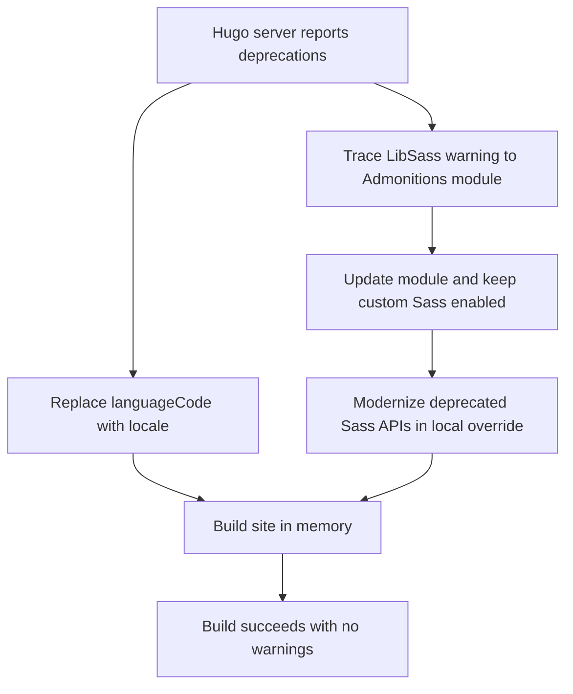

## Resolving Some Hugo Deprecation Warnings

When ever I worked on my Hugo driven site, the Hugo server output included two deprecation warnings:

1. The project configuration used the deprecated `languageCode` key.
2. The Hugo Admonitions module selected the deprecated LibSass transpiler by default.

Both warnings were addressed. Updating the Admonitions module exposed additional Dart Sass deprecation notices in the site's local Admonitions stylesheet, so those legacy Sass APIs were also modernized. The site then built successfully in memory with no warnings.

> [!NOTE]
> The module-download and file-watching messages in `hugo server` are ordinary startup output, not deprecation warnings.

## Why the changes were needed

### Replace `languageCode` with `locale`

Hugo deprecated the project-level `languageCode` setting in v0.158.0 and recommends `locale`. Leaving the old key in place would continue producing a warning and risks a future Hugo release rejecting it.

The site's configured language and region were `en-us`. The equivalent locale was set to the canonical language-tag form, `en-US`.

### Stop using LibSass

The project already explicitly selected Dart Sass for its main stylesheet in [`layouts/partials/head.html`](layouts/partials/head.html). The LibSass warning came from elsewhere: the pinned `hugo-admonitions` v0.10.1 module compiled its own stylesheet without specifying a transpiler, causing Hugo to use its deprecated LibSass default.

That default is unsafe to leave in place: Hugo's warning says to use Dart Sass, and Hugo's own implementation notes that LibSass is removed in v0.170.0.

### Keep the site's custom Admonitions styling

The site has local Admonitions Sass overrides, including custom colors and light/dark theme values. Simply switching to the module's precompiled CSS could have bypassed those overrides. The module update therefore explicitly keeps Sass compilation enabled.

## Changes made

### 1. Updated the Hugo locale setting

In [`hugo.toml`](hugo.toml), replaced:

```toml
languageCode = "en-us"
```

with:

```toml
locale = "en-US"
```

This removes the deprecated key while retaining the site's English (United States) locale.

### 2. Updated Hugo Admonitions and retained Sass customization

Updated the module dependency from v0.10.1 to v0.12.5 in [`go.mod`](go.mod), with its checksums recorded in [`go.sum`](go.sum).

Added this setting to [`hugo.toml`](hugo.toml):

```toml
[params.hugoadmonitions]
enablesass = true
```

The newer module uses Dart Sass when this option is enabled. Keeping it enabled ensures the local Sass customization remains active instead of silently switching to the module's precompiled stylesheet.

### 3. updated the local Admonitions Sass

Once the module used Dart Sass, the build reported Dart Sass deprecations in the site's local override, [`assets/sass/vendors/_admonitions.scss`](assets/sass/vendors/_admonitions.scss). These came from legacy Sass `@import` and global function calls.

The override now uses Sass modules:

```scss
@use "sass:color";
@use "sass:list";
@use "sass:map";
@use "admonitions-user-settings" as *;
```

The deprecated calls were replaced with module equivalents:

| Before | After |
| --- | --- |
| `@import "admonitions-user-settings"` | `@use "admonitions-user-settings" as *` |
| `map-merge(...)` | `map.merge(...)` |
| `join(...)` | `list.join(...)` |
| `mix(...)` | `color.mix(...)` |

These are syntax/API migrations; the existing color values, selectors, and styling behavior were retained.

## Reasoning and implementation flow

The key distinction was that the project's own stylesheet pipeline and the module's Sass pipeline were separate. Since the project template already selected Dart Sass, changing that call alone would not have fixed the warning. The module's render hook had to be updated as well.



## Verification

Ran:

```sh
hugo --renderToMemory
```

The build completed successfully using Hugo v0.168.0. It reported:

```text
Pages            257
Paginator pages   35
Non-page files    52
Static files      15
Processed images  24
Aliases           75
```

There were no Hugo or Dart Sass deprecation warnings in the verification output. `git diff --check` also completed without reporting whitespace errors.

> [!TIP]
> Restart `hugo server` with the usual command to confirm the same clean startup in the interactive preview. `hugo --renderToMemory` validated the full site build; it did not run the long-lived server process. I use `hugo server --gc --noHTTPCache --ignoreCache --openBrowser --disableFastRender`
